  

<h1 align="center">Hi, I'm Benjamin Cheng</h1>

  <picture>
    <source media="(prefers-color-scheme: dark)" srcset="https://readme-typing-svg.demolab.com?font=Fira+Code&amp;weight=600&amp;size=22&amp;duration=4000&amp;pause=1000&amp;color=B83A4B&amp;center=true&amp;vCenter=true&amp;width=700&amp;lines=Statistics+%26+Data+Science+%40+Stanford;Machine+Learning+%7C+AI+Systems+%7C+Research;From+model+evaluation+to+reliable+software" />
    
  </picture>

  
  
  

---

## About Me

I'm a **Statistics & Data Science master's student at Stanford** with a background in machine learning research and software engineering. My work spans LLM evaluation, reinforcement learning, scientific visualization, and AI systems.

- 🎓 **M.S. Statistics & Data Science, Stanford University** - expected June 2028.
- 🎓 **B.S. Data Science, University of Michigan–Ann Arbor** - May 2026; University Honors and James B. Angell Scholar.
- 🧠 **Research Assistant, Stanford Medical School** - working on GPU-accelerated generative modeling and ML pipelines for 3D MRI generation.
- 🛠️ Previously built AI evaluation and research tools at **MatrAIx.ai** and **Reflect Ventures**, and scientific software at **Glue Solutions** and **Harvard**.
- 🔬 Research interests: **generative modeling, reinforcement learning, LLM evaluation, and human-AI interaction**.

## 🚀 Selected Work

<table>
  <tr>
    <td width="50%" valign="top">
      <h3>💳 PayLedger</h3>
      
A distributed payment idempotency service built around a <b>three-node Raft cluster</b> and transactional BadgerDB. Validated that <b>32 concurrent duplicate requests resolve to one payment ID</b> while preserving replicated writes.

      
<b>Stack:</b> Go · REST · gRPC / Protobuf · HashiCorp Raft · BadgerDB · Docker

      
<a href="https://github.com/ChesleyC/pay-ledger">View repository →</a>

    </td>
    <td width="50%" valign="top">
      <h3>🧪 Oralytics · Reinforcement Learning</h3>
      
Built an online RL simulation, model-validation, and monitoring framework at Harvard. Trained <b>142 generative models</b> and generated <b>~35K Monte Carlo trajectories</b>; model evaluation demonstrated a <b>22% AUC lift</b> over legacy models.

      
<b>Methods:</b> AR(1) logistic models · Monte Carlo simulation · LOSO evaluation · Mondrian Forest

      
<i>Harvard University · Research Assistant · April–July 2025</i>

    </td>
  </tr>
  <tr>
    <td width="50%" valign="top">
      <h3>📊 Glue Solara · Data Linker</h3>
      
Led development of a registry-driven Data Linker that discovered and cached <b>50+ link types</b>, including astronomical coordinate transformations, mathematical functions, and database joins. Brought Qt desktop linking workflows to a state-managed web editor.

      
<b>Stack:</b> Python · Solara · glue-core · glue-qt

      
<a href="https://github.com/ChesleyC/glue-solara-cc">View development fork →</a>

    </td>
    <td width="50%" valign="top">
      <h3>🧥 Take-A-Sweater</h3>
      
Modernized a weather application at Harvard by replacing a legacy SOAP feed with the <b>NOAA REST API</b> and rebuilding its Docker stack. Extended three weather-table schemas, backfilled <b>~814K records spanning ~20 years</b>, and expanded coverage from Boston to <b>eight cities</b>.

      
<b>Stack:</b> PHP · SQL · NOAA REST API · Docker

      
<a href="https://takeasweater.com">Visit website →</a>

    </td>
  </tr>
</table>

## 🛠️ Tech Stack

  

| Area | Technologies & methods |
| :-- | :-- |
| **Machine Learning & Data** | PyTorch · scikit-learn · Hugging Face · Pandas · NumPy · reinforcement learning · Monte Carlo simulation |
| **Backend & APIs** | Flask · Node.js · REST · gRPC / Protobuf · HTTPX · Pydantic · pytest |
| **Databases & Distributed Systems** | SQL · MySQL · SQLite · MongoDB · BadgerDB · Raft · MapReduce |
| **Interfaces & Scientific Tools** | React · Svelte · D3.js · Solara · glue-core · glue-qt |

---

  

---

  Interested in ML research, AI systems, or scientific software? <a href="https://www.linkedin.com/in/benjamin-cheng-b49219275">Let's connect.</a>

